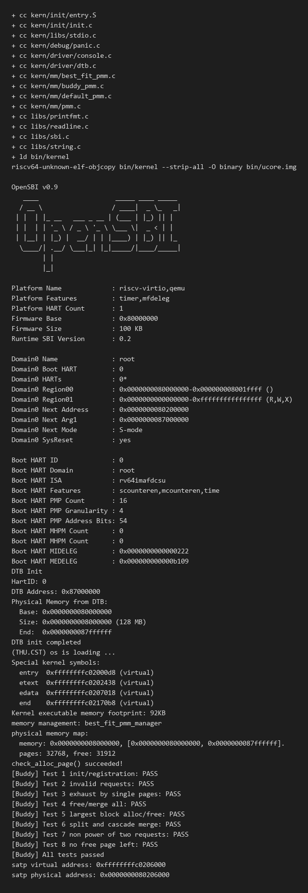
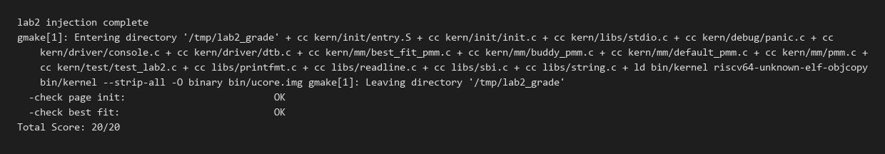

# 操作系统实验报告

## 实验基本信息

| 项目 | 内容 |
|------|------|
| **实验名称** | Lab 2: 物理内存管理（物理内存探测、页描述符、Best-Fit 与 Buddy System） |
| **小组成员** | 2413238-罗清、2412951-申一博、2413191-马云飞 |
| **完成日期** | 2026-10-22 |

### 小组分工

| 成员 | 负责的练习/模块 |
|------|----------------|
| 2413238-罗清 | 功能模块一 `page_init()`、QEMU 6.2 适配与评分脚本修正、报告统稿 |
| 2412951-申一博 | 功能模块二任务一（First-Fit 理解）、任务二 Best-Fit 实现与接入 |
| 2413191-马云飞 | 功能模块二任务三 Buddy System 模块与自测设计 |

> 注：所有代码均由三人分别审阅、共同调试，测试结果经小组一起复核。如实际分工不同请告知调整。

---

## 一、实验目的

1. 理解操作系统如何从设备树（DTB）发现物理内存范围，并据此建立 `struct Page` 页描述符。
2. 掌握物理内存管理框架 `struct pmm_manager` 的调用链：`init → init_memmap → alloc_pages/free_pages → check`。
3. 读懂 First-Fit 的初始化、分配与合并流程，并在此基础上实现 Best-Fit。
4. 从零实现 Buddy System，理解 2 的幂块、按地址对齐、逐级分裂与级联合并。
5. 练习用四段式提示词（PROMPT / RELY / GUARANTEE / SPECIFICATION）约束 AI 生成可验证的内核代码。

---

## 二、实验环境

| 成员 | AI 编程工具 | 底层模型 | 备注 |
|------|------------|---------|------|
| 2413238-罗清 | TraeCode（Agent 模式） | GLM-5.3-Flash | 具备项目文件读写与命令执行能力 |
| 2412951-申一博 | TraeCode（Agent 模式） | GLM-5.3-Flash | 具备项目文件读写与命令执行能力 |
| 2413191-马云飞 | TraeCode（Agent 模式） | GLM-5.3-Flash | 具备项目文件读写与命令执行能力 |

**基础环境：**

- 宿主机：Windows 11 + WSL2（Ubuntu 22.04）
- 交叉编译器：`riscv64-unknown-elf-gcc` 10.2.0
- 模拟器：`qemu-system-riscv64` 6.2.0（内置 OpenSBI v0.9）
- 构建：GNU Make；内核通过 `-kernel bin/ucore.img` 加载到 `0x80200000`
- 评分：`make grade`（`tools/inject.py` 注入测试 + `tools/grade.sh` 采集 QEMU 串口输出）

---

## 三、实验整体逻辑分析

### 3.1 本章节的逻辑主线

lab2 的主线是**让内核真正“拥有”物理内存**：先发现有多少可用物理内存，再为每个 4KB 物理页建立
描述符，最后把这些页交给一个页面分配器管理，使内核可以使用 `alloc_pages/free_pages` 申请和归还
连续物理页。

整个实现链可以概括为：

```text
pmm_init()
  ├─ init_pmm_manager()      选择并初始化分配器（init）
  ├─ page_init()             探测物理内存、建立 Page 数组、注册空闲页
  │    └─ init_memmap()      把空闲页挂入分配器的空闲链表
  └─ check_alloc_page()      运行分配器的自检（check）
```

### 3.2 功能的逐步实现

1. **先选定分配器框架**：`pmm_init()` 一进来就调用 `init_pmm_manager()`。因为后续
   `init_memmap`、`alloc_pages`、`free_pages` 都是通过 `pmm_manager` 的函数指针分发的，
   没有管理器就无法登记空闲页。
2. **再初始化物理内存**：`page_init()` 从 DTB 取得物理内存范围，在 `end` 之后建立页描述符数组，
   再把“排除 OpenSBI、内核镜像、描述符数组”后的完整页交给 `init_memmap()`。没有这一步，
   分配器内部是空的，任何 `alloc_pages` 都会失败。
3. **最后自检**：`check_alloc_page()` 调用管理器自己的 `check()`，用真实的分配/释放序列验证
   空闲链表、`property` 和 `nr_free` 的一致性。
4. **在框架内替换算法**：把 `pmm_manager` 从 First-Fit 换到 Best-Fit，只改变“选哪一块”，
   页面初始化与描述符约定完全复用，体现了框架的接口稳定性。
5. **再扩展到 Buddy**：Best-Fit 用一条按地址有序的空闲链；Buddy 则需要按阶（order）组织多条
   空闲链，分配时分裂、释放时找伙伴合并，进一步理解“外部碎片”与“2 的幂块”的权衡。

---

## 四、实验内容与实现

### 功能模块一：物理内存初始化功能

**负责人：** 2413238-罗清

#### 模块功能描述

**需要实现的函数：**

```c
static void page_init(void);   // kern/mm/pmm.c
```

**功能说明：** 根据设备树提供的物理内存信息建立可管理物理页的描述符布局，并把排除 OpenSBI、
内核镜像和描述符数组占用空间后的完整空闲页面交给当前 `pmm_manager` 管理。成功返回时
`va_pa_offset`、`npage`、`pages` 均正确，且当前管理器的空闲区已经建立。

#### 最终提示词

完整四段式提示词见本目录 [prompt.md](./prompt.md) 的“提示词 1”。核心约束摘录：

```text
[PROMPT] 在 kern/mm/pmm.c 实现 page_init()：从 get_memory_base()/get_memory_size() 取内存范围，
设置 va_pa_offset/npage/pages；把排除 OpenSBI、内核镜像、描述符数组后的完整空闲页交给
init_memmap；信息无效 panic，无完整空闲页不得调用 init_memmap；不得改 pmm_init 调用顺序与启动页表。
[RELY] PHYSICAL_MEMORY_OFFSET=0xFFFFFFFF40000000；PADDR(kva)=kva-va_pa_offset；
page2ppn=page-pages+nbase；init_memmap 要求 base 起 n 页当前均为 PageReserved；
kernel.ld 提供 end；QEMU 内存 [0x80000000,0x88000000)，nbase=0x80000。
[GUARANTEE] 不改测试函数；-Werror 编译通过；make grade 的 Test 1 必须 PASS。
[SPECIFICATION] va_pa_offset/npage/pages 的具体取值；pages 页对齐且 ≥ ROUNDUP(end)；
所有描述符先 reserved；空闲区 = [ROUNDUP(描述符数组末尾PA), ROUNDDOWN(内存末尾PA))；
打印内存范围、描述符页数与空闲页数。
```

#### 实现思路

1. **三种地址必须分清**：DTB 给的是物理地址；`end`、`pages` 是内核虚拟地址；`npage`、`nbase`
   是物理页号。物理地址用 `PADDR()` 从内核虚拟地址换算，页号用 `PPN()`。
2. **页描述符数组的放置**：`pages = ROUNDUP(end, PGSIZE)`，紧跟内核镜像之后。数组长度为
   `npage - nbase`，因为只有 `[nbase, npage)` 这一段 DRAM 需要描述符（`0x80000000`
   以下是 OpenSBI 区域，没有对应描述符）。
3. **先全部 reserved，再放行空闲页**：循环把每个描述符的 `flags` 置为 reserved、
   `ref/property` 清零。这样内核镜像所在页、描述符数组自身所在页天然不会被分配；
   只有真正空闲的页才会在 `init_memmap()` 中被清除 reserved 并挂入空闲链。
4. **空闲区边界**：
   - 起点：描述符数组末尾的物理地址向上取整到 4KB；
   - 终点：DTB 报告的内存末尾向下取整到 4KB；
   - 若起点 ≥ 终点，说明没有完整空闲页，直接返回，**不调用** `init_memmap()`。
5. **失败处理**：DTB 未提供内存信息（`mem_base==0 || mem_size==0`）时 `panic`；
   `npage <= nbase` 时同样 `panic`。

#### 实现迭代过程

本模块按上述思路实现后一次通过：

1. `make qemu` 输出 `pages: 32768, free: 31912`，说明 128MB 被完整覆盖，且内核镜像与
   描述符数组占用的 856 页被正确保留。
2. `make grade` 的 `[Test 1] Page Init: PASS`，其中对 `va_pa_offset`、`npage`、描述符对齐、
   内核尾页 reserved、描述符数组 reserved、`pa2page(page2pa(q))==q` 的检查全部通过，
   未再修改 page_init 代码。

**关键环境适配（非算法问题）：** 骨架 Makefile 使用 QEMU 4.1 时代的
`-device loader,file=bin/ucore.img,addr=0x80200000`。在 QEMU 6.2 + OpenSBI v0.9 下，
该方式不会把内核登记为固件的下一阶段地址（banner 中 `Domain0 Next Address = 0x0`），
内核不会被执行。将 `qemu/debug/test` 目标与 `tools/grade.sh` 的 `qemuopts` 统一改为
`-kernel bin/ucore.img` 后，`Next Address = 0x80200000`，内核正常启动。

---

### 功能模块二任务一：理解 First-Fit 连续物理内存分配算法（思考题）

**负责人：** 2412951-申一博

#### 1. First-Fit 的四个阶段

- **`default_init`**：初始化空闲链表头 `free_list`，并把空闲页总数 `nr_free` 置 0。
- **`default_init_memmap(base, n)`**：把 `[base, base+n)` 这 n 个连续页登记为**一个**空闲块。
  先逐页断言它们当前是 reserved，然后清 `flags/property/ref`；再让块头
  `base->property = n`、`SetPageProperty(base)`，`nr_free += n`；最后按地址顺序把块头插入
  空闲链表（链表按页地址升序，方便后续合并）。
- **`default_alloc_pages(n)`**：从链表头开始扫描，找到**第一个** `property >= n` 的块就停止，
  这就是 First-Fit。取出该块后，如果块比请求大，就把 `page+n` 开始的剩余部分作为新块头
  （`property = 原大小-n`）插回原位置；`nr_free -= n`，并清除被分配块头的 PG_property。
- **`default_free_pages(base, n)`**：先逐页断言不是 reserved 且不是空闲块头，清
  `flags/ref`；把释放区重新组成一个块（`property=n`、`SetPageProperty`、`nr_free += n`），
  按地址插入链表；随后检查**前一个**块是否与 `base` 相邻（`p + p->property == base`），
  是则合并；再检查**后一个**块是否相邻（`base + base->property == p`），是则合并。
  由于链表有序且每次最多合并左右各一个块，合并后仍然有序。

#### 2. First-Fit 是否有改进空间？

有，主要有三个方向：

1. **扫描开销**：每次分配都从链表头线性扫描，最坏 O(块数)。可以按块大小建立多级空闲链表
   （segregated free list），或维护“第一块足够大的位置”的游标，减少重复扫描。
2. **碎片**：First-Fit 容易在低地址留下大量小洞（外部碎片）。可结合“下次适配/最佳适配”、
   延迟合并（只在必要时合并）、或按地址分配以保持大块连续。
3. **分配粒度**：对内核频繁申请的小对象，页级分配粒度太粗，可加 slab/SLUB 之类的
   对象缓存层，把页级分配与对象级分配分开。

---

### 功能模块二任务二：Best-Fit 连续物理内存分配算法

**负责人：** 2412951-申一博

#### 模块功能描述

**需要实现的函数（本文件不提供声明，需自行设计）：**

```c
static void best_fit_init(void);
static void best_fit_init_memmap(struct Page *base, size_t n);
static struct Page *best_fit_alloc_pages(size_t n);
static void best_fit_free_pages(struct Page *base, size_t n);
static size_t best_fit_nr_free_pages(void);
const struct pmm_manager best_fit_pmm_manager;   // 注册到框架
```

同时在 `kern/mm/pmm.c` 的 `init_pmm_manager()` 中把 `pmm_manager` 切换为
`&best_fit_pmm_manager`。

#### 最终提示词

完整四段式提示词见 [prompt.md](./prompt.md) 的“提示词 2”。核心约束摘录：

```text
[PROMPT] 在 best_fit_pmm.c 从零实现 Best-Fit 模块并定义 best_fit_pmm_manager；
alloc_pages 必须真正选择“满足请求的最小空闲块”，不能退化为 First-Fit；
free_pages 按地址有序插入并向前向后合并；不得修改 basic_check / best_fit_check。
[RELY] struct pmm_manager 六个成员；default_pmm.c 的 First-Fit 语义；
best_fit_check 要求 alloc_pages(1) 返回 p0+4 而非 p0+1 的 2 页块；
free_pages(p0,5) 必须能合并 p0、p0+1..2、p0+4 以支持 alloc_pages(5)。
[GUARANTEE] 不改测试；不引入动态内存；-Werror；任意序列后 total(property)==nr_free_pages()。
[SPECIFICATION] init/init_memmap/free_pages 与 First-Fit 语义相同（有序链表+双向合并）；
alloc 扫描全部块记录 property≥n 的最小者，相等可提前结束；若剩余则拆分并插回原位置。
```

#### 实现思路

- **初始化与登记**：`best_fit_init_memmap` 与 First-Fit 相同——整段连续页作为一个块登记，
  按地址有序插入。只有分配策略不同。
- **分配**：遍历整条空闲链，记录所有 `property >= n` 的块中 `property` 最小者；
  一旦遇到 `property == n` 的块即可提前结束（没有更小的可满足块）。取块后若还有剩余，
  把 `page + n` 作为新块头（`property = 原大小 - n`）插回被取块原来的位置，保证链表仍按地址有序。
- **释放**：逐页清状态，把释放区组成块并按地址插入，然后检查前、后相邻块并合并。
- **接入**：`best_fit_check` 同时验证 `basic_check`（独立分配/释放 3 页）和
  针对 Best-Fit 的序列（`alloc(1)` 必须返回仅 1 页的 `p0+4`；`free(p0,5)` 必须合并
  `p0..p0+4` 后支持 `alloc(5)`）。

#### 实现迭代过程

本模块初版实现一次通过：分配循环一开始就按“遍历整条链并记录最小可满足块”编写，
没有沿用 First-Fit 的 `>= n` 即 break；`free_pages` 复用 First-Fit 的有序插入与双向合并。
运行 `make grade` 后 `[Test 2] Best-Fit: PASS`，总分 20/20。

验收时重点核对了两个容易退化的点：

- `alloc_pages(1)` 在 `p0+1`（2 页块）与 `p0+4`（1 页块）同时存在时必须返回 `p0+4`；
- `free_pages(p0, 5)` 必须把 `p0`、`p0+1..2`、`p0+4` 三段合并成 5 页块，否则
  `alloc_pages(5)` 会失败。

#### Best-Fit 是否有改进空间？

有：

1. **扫描复杂度**：当前每次分配 O(块数)。可按块大小组织多条链（如按 2 的幂分级），
   或在链表中维护按大小的索引/线段树，把“找最小可满足块”降到 O(log n)。
2. **长期碎片**：Best-Fit 只对“本次请求”最优，容易把大块切出许多难以再利用的小块；
   可结合“若最小块与请求差距过大则改用更适合的块”、延迟合并或块大小分级。
3. **有序链表的插入成本**：释放时按地址插入需要线性扫描，可改用地址索引或跳表；
   若改为按大小排序，则释放合并要同时维护地址邻接关系，需要额外结构。

---

### 功能模块二任务三：Buddy System 分配算法

**负责人：** 2413191-马云飞

#### 模块设计

新增 `kern/mm/buddy_pmm.c` / `buddy_pmm.h`，注册 `buddy_pmm_manager`。核心设计：

- **块与阶**：块大小为 `2^order` 页，`MAX_ORDER = 10`（最大 4MB）。空闲块头页的
  `property` 存 order，`PG_property` 标记它是空闲块头；非块头空闲页 `flags/property` 均为 0。
- **多条空闲链**：`free_area_t buddy_free_area[MAX_ORDER+1]`，每一阶一条双向链表，
  另有每阶计数与全局 `nr_free`。
- **登记（init_memmap）**：把 `[base, base+n)` 按“当前地址可对齐的最大阶 + 不超过剩余长度”
  贪心拆成若干块。例如起始页号是奇数时先登记 1 页块，下一地址对齐到 2 页、4 页……，
  很快形成大块。块地址必须按自身大小对齐，否则“地址异或块大小”求出的伙伴不是相邻块。
- **分配**：把 n 向上取整到 `2^k`，从 k 阶向上找第一个非空链；取块后逐级对半分裂，
  右半块作为新块头挂入低一阶链，直到块大小等于 `2^k`。
- **释放**：清页状态、按阶挂链，然后循环：
  `buddy_pa = pa ^ (2^order << 12)`，若伙伴在本次管理范围内、是空闲块头且阶相同，
  则把两块从当前阶链表摘下，合并后的低地址块作为新块头，`order++` 后挂入高一阶链。
- **边界**：登记时记录管理范围 `[buddy_region_base, buddy_region_pages)`，合并时若伙伴
  超出该范围立即停止，避免访问不属于本分配器的页描述符。

#### 最终提示词

本任务按要求设计两份 prompt：

1. **第一份**（生成模块）：见 [prompt.md](./prompt.md) 的“提示词 3”。核心是
   “只利用 struct Page 现有字段、按阶维护多条空闲链、贪心登记对齐块、分配逐级分裂、
   释放按地址异或找伙伴并跨阶合并、合并不得越界”。
2. **第二份**（设计测试）：见 [prompt.md](./prompt.md) 的“提示词 4”。核心是
   “用私有页描述符池隔离测试、不影响当前 pmm_manager、覆盖初始化/非法请求/耗尽/
   完全合并/最大块/强制分裂/非 2 幂/无空闲页，并用 assert 判定”。

#### 测试覆盖说明

`buddy_test()` 共 8 个用例，均在私有的 1024 页描述符池上运行：

| 用例 | 覆盖的核心行为/边界 | 为什么能检验实现 |
|------|--------------------|------------------|
| 1 初始化/登记 | 总空闲页数、块头 property、块地址按阶对齐、每阶计数一致 | 若贪心拆分或对齐判断错误，块大小之和或对齐断言会立即失败 |
| 2 非法请求 | `n=0`、`n > nr_free` | 检验入口参数检查，避免空指针/越界返回 |
| 3 逐页耗尽 | 每次申请 1 页直至 NULL，所有链为空、所有返回页非空闲块头 | 检验逐级分裂能否把每个大块完整拆开，且不重复分配同一页 |
| 4 全部释放 | 空闲页数与每阶块数恢复到初始快照 | 只有分裂/合并完全对称时才能恢复，能发现“合并后忘记换链”的错误 |
| 5 最大块 | 取出最大阶块再释放，块头与结构恢复 | 检验取块不拆分、释放能正确挂回并保持对齐 |
| 6 强制分裂 + 级联合并 | 先占满所有低阶块，再申请 1 页必然分裂大块；逆序释放后恢复快照 | 强制走到 `alloc` 的分裂路径与 `free` 的多级合并路径 |
| 7 非 2 幂请求 | `3` 页按 4 页分配、`5` 页按 8 页分配，释放后完全恢复 | 检验向上取整与释放时按同一阶回收 |
| 8 无空闲页 | 耗尽后再申请 1 页必须 NULL | 检验 `n > nr_free` 与空链判断 |

这些测试之所以有效，是因为它们同时检查**返回值**、**页状态（reserved/property/ref）**、
**每条链的块数与总页数**，并且每个用例结束都要求恢复到初始快照；任何一次分裂/合并
不对称、跨阶链表迁移遗漏或越界合并都会破坏快照。

#### 实现迭代过程

Buddy 模块在自测阶段经过 4 次修正，除第 4 次是测试断言与实现约定不一致外，
前 3 次都是分配器本身的真实缺陷：

1. **第一次**：合并时只把伙伴块 `list_del`，没有把合并后的块从低阶链摘除并挂到高阶链。
   结果 2 页的合并块仍留在 order-0 链上，`test_total_free()` 按链的阶统计时少算了一半页，
   `Test 4` 触发 `test_total_free() == BUDDY_TEST_PAGES` 断言失败。
   **修正**：合并时同时 `list_del` 当前块，`order++` 后 `list_add` 到新阶链表，
   并同步维护两阶的 `nr_free` 计数。
2. **第二次**：与上一条同批修正——当伙伴在低地址时，代码清除了将成为新块头的伙伴的
   `PG_property`，导致新块头不再是“空闲块头”，后续无法继续向上合并。
   **修正**：统一选低地址块为新块头，对**被吸收**的高地址块 `ClearPageProperty` 并清 property，
   对新块头 `SetPageProperty`。
3. **第三次**（复查时预防性修正）：私有测试池的起始页号可能不对齐，释放时按地址异或求出的
   “伙伴”可能落在池外，读到池前的其他全局变量，存在误合并和链表损坏风险。
   **修正**：在 `init_memmap` 记录管理范围，`free_pages` 合并前检查伙伴块完全落在范围内。
4. **第四次**：`Test 5` 的断言写的是“分配块头 property 应等于 order”，与实现约定不一致——
   实现约定已分配块头的 property 清零（非空闲块头），故触发 panic。
   **修正**：把断言改为 `property==0 && !PageProperty(p)`。

修正后 8 个用例全部 PASS，`make qemu` 输出 `[Buddy] All tests passed`。

---

### Challenge：任意大小内存单元 SLUB 分配算法（选做）

本组本次**未完成** SLUB Challenge，仅完成实验要求的 page_init、Best-Fit 与 Buddy System。
因此报告中不包含 SLUB 的两份 prompt 与测试说明。

---

## 五、测试与验证

**QEMU 运行输出**（包含编译、OpenSBI、DTB、page_init 统计与 Buddy 自测）：



说明：内核在 `pmm_init()` 后进入 `while(1)`，QEMU 不会自行退出，截图中为手动终止前的完整输出。

**评分结果**（`make grade`）：



```text
  -check page init:                          OK
  -check best fit:                           OK
Total Score: 20/20
```

关键输出摘录：

```text
Physical Memory from DTB:
  Base: 0x0000000080000000
  Size: 0x0000000008000000 (128 MB)
memory management: best_fit_pmm_manager
physical memory map:
  memory: 0x0000000008000000, [0x0000000080000000, 0x0000000087ffffff].
  pages: 32768, free: 31912
check_alloc_page() succeeded!
[Test 1] Page Init: PASS
[Test 2] Best-Fit: PASS
[Buddy] All tests passed
```

---

## 六、实验总结与收获

### 6.1 重要知识点与 OS 原理的对应关系

| 本实验知识点 | OS 原理中的对应概念 | 含义、关系与差异 |
|--------------|--------------------|------------------|
| DTB 解析物理内存范围 | 硬件发现 / 设备树 | 原理中常假设“已知物理内存大小”，实验中必须从固件传递的 DTB 读取 `memory` 节点；这是真实 OS 启动时获得 RAM 布局的标准方式 |
| `struct Page` 页描述符 | 页框管理 / 页表项之外的内核数据结构 | 原理讲“为每个页框建描述符、用位图或链表管理”；实验中用 40 字节的 `struct Page` 数组，`ref` 是引用计数，`flags` 是状态位，`property`/`page_link` 供分配器使用 |
| `va_pa_offset`、`PADDR` | 内核直接映射 / 地址转换 | 原理区分虚拟地址与物理地址；实验中内核通过 1GiB 大页把整个 DRAM 线性映射，`PADDR` 只是减去固定偏移，属于“恒等映射的简化版” |
| `init_memmap` + 空闲链表 | 空闲空间管理（连续分配） | 原理讲首次适配/最佳适配/最坏适配；实验用双向链表保存 (起始页, 长度)，`property` 就是块长 |
| Best-Fit | 动态分区分配算法 | 与原理一致：选择最小可满足块；差异是实验按**页**分配、以页描述符数组下标表示地址，且必须与测试的状态约定一致 |
| Buddy System | 伙伴系统 / 外部碎片 | 原理讲按 2 的幂分块、分裂与合并；实验中“伙伴 = 地址异或块大小”，并要求块地址按自身大小对齐，合并时跨阶迁移链表 |
| `nr_free` 与各阶计数 | 空闲页统计 / 分配器不变量 | 原理中分配器需要维护空闲量用于判断能否满足请求；实验中还要求“链上块长之和 == nr_free”，这是自测的核心不变量 |
| `-kernel` 与 OpenSBI 移交 | 引导加载 / 固件接口 | 原理讲 bootloader 把内核装入内存并跳转；实验中 QEMU 的 `-device loader` 不登记下一阶段地址，必须用 `-kernel` 让固件把内核地址写入启动信息 |

### 6.2 OS 原理中很重要、但本实验没有对应上的知识点

1. **虚拟内存与缺页异常**：lab2 只建立了启动用的 1GiB 大页映射，没有实现按需分页、
   页表项权限维护和缺页处理。
2. **进程/线程与地址空间隔离**：没有用户态进程，也没有为不同进程切换 `satp`。
3. **并发与锁**：实验是单核、关中断的启动阶段，分配器没有考虑多核并发下的空闲链保护。
4. **页面换出与回收**：没有 swap、页面回收（LRU）等机制，`ref` 只做计数，没有实际回收策略。
5. **内存映射文件、共享内存**：属于后续 lab 的内容。

### 6.3 AI 协作开发的经验

- 内存管理代码“看起来对”不等于对：必须把**不变量**写进 prompt（如
  `total(property)==nr_free`、合并块必须换链、伙伴必须在管理范围内），AI 生成后
  用断言逐条验收，才能发现跨阶链表、合并方向这类隐蔽错误。
- 把“地址类型”写进 [RELY] 能显著减少错误：VA、PA、PPN 混用是本次最容易出错的地方，
  明确 `PADDR`、`page2pa`、`PPN` 的适用场景后，page_init 一次通过。
- 测试要隔离：Buddy 的测试放在私有描述符池上，既不干扰当前 Best-Fit 的评分路径，
  又能完整复现分裂/合并；如果直接在真实空闲区上测试，失败时会污染管理器状态，
  后续测试全部失真。
- 环境问题要用真实输出定位：`Domain0 Next Address = 0x0` 与 `-kernel` 后的
  `0x80200000` 是判断 QEMU 加载方式的直接证据，比猜测 Makefile 写法更快。
