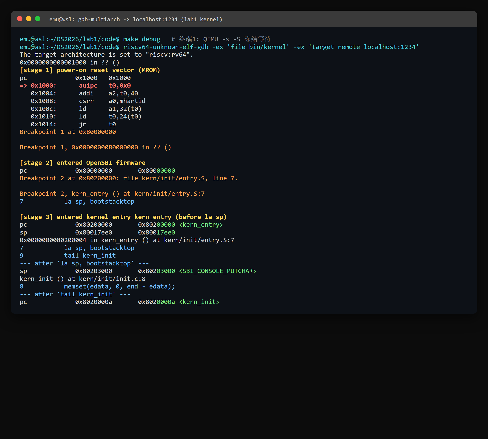
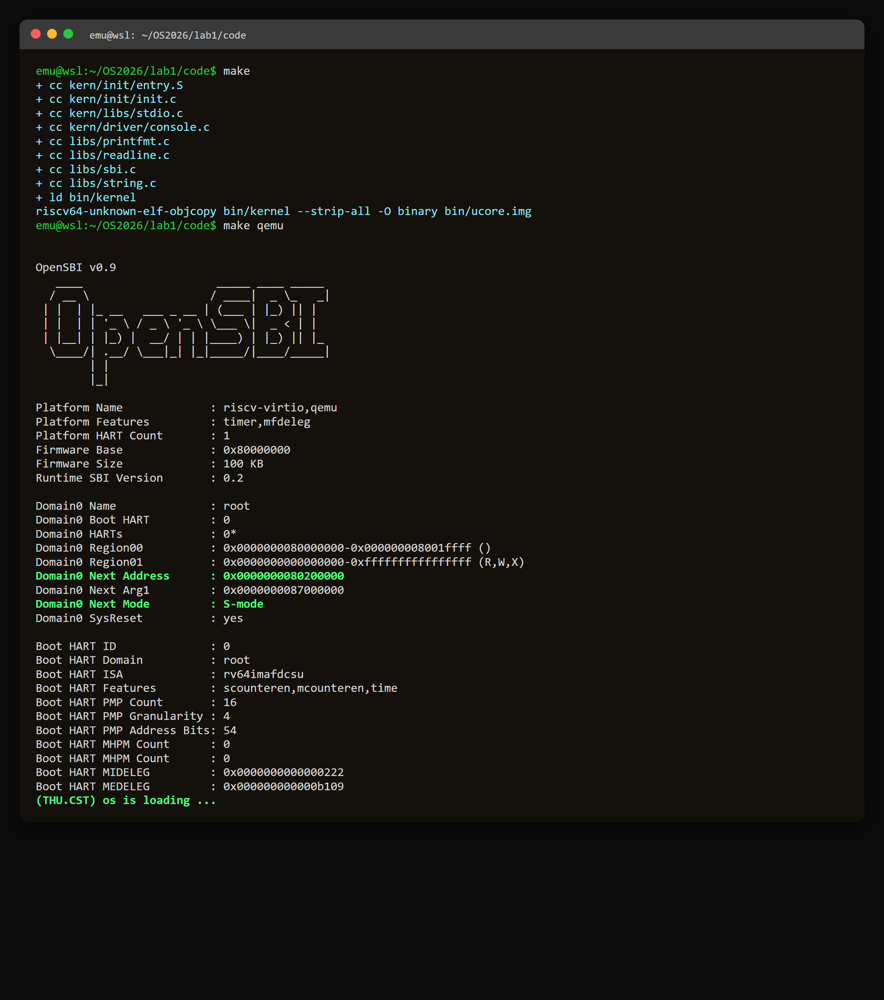

# 操作系统实验报告

## 实验基本信息

| 项目 | 内容 |
|------|------|
| **实验名称** | Lab 1: 比麻雀更小的麻雀（最小可执行内核） |
| **小组成员** | 2413238-罗清、2412951-申一博、2413191-马云飞 |
| **完成日期** | 2026-10-11 |

### 小组分工

| 成员 | 负责的练习/模块 |
|------|----------------|
| 2413238-罗清 | 实验环境搭建与 QEMU 6.2 适配、练习结果复核、报告统稿 |
| 2412951-申一博 | 练习1（entry.S 入口指令 `la sp`/`tail` 的作用分析） |
| 2413191-马云飞 | 练习2（GDB 跟踪 0x1000→0x80200000 启动流程与结果记录） |

> 注：两项练习的结论均经小组讨论确认，实验报告由三人共同校对。如实际分工不同请告知调整。

---

## 一、实验目的

1. 掌握 RISC-V 机器从上电到内核 main 函数之间的完整启动接力过程：复位 ROM → OpenSBI 固件 → 内核入口汇编 → C 语言 `kern_init`。
2. 理解内核入口处栈的建立方式，以及汇编入口如何把控制权转交给 C 代码。
3. 掌握 QEMU + GDB 远程调试操作系统内核的方法，能够在真实地址上验证启动流程。
4. 熟悉本课程 AI 辅助开发的工作闭环：阅读代码—提出需求—修改—编译—运行验证。

---

## 二、实验环境

| 成员 | AI 编程工具 | 底层模型 | 备注 |
|------|------------|---------|------|
| 2413238-罗清 | TraeCode（Agent 模式） | GLM-5.3-Flash | 具备项目文件读写与命令执行能力 |
| 2412951-申一博 | （请补充） | （请补充） | |
| 2413191-马云飞 | （请补充） | （请补充） | |

**基础环境：**

- 宿主机：Windows 11 + WSL2（Ubuntu 22.04）
- 交叉编译器：`riscv64-unknown-elf-gcc` 10.2.0
- 模拟器：`qemu-system-riscv64` 6.2.0（内置 OpenSBI v0.9）
- 调试器：`gdb-multiarch` 12.1（映射为 `riscv64-unknown-elf-gdb`）
- 构建：GNU Make，内核通过 `-kernel` 加载到 `0x80200000`

---

## 三、实验整体逻辑分析

### 3.1 本章节的逻辑主线

lab1 的主线是**让一段自己编写的 C 代码在内核态跑起来并输出一行字符**。它解决的核心问题是：一台没有操作系统的"裸机"加电后，控制权是如何一步步从硬件移交到我们写的 `kern_init()` 函数的。

### 3.2 启动的三级接力

实验代码的执行顺序与依赖关系如下：

1. **CPU 复位 → MROM（`0x1000`）**：CPU 硬件把 PC 强制设为固定复位地址，执行 QEMU 固化在 MROM 中的一小段汇编，准备启动参数并跳转到固件。
2. **OpenSBI 固件（`0x80000000`）**：运行在 M-mode，完成最底层硬件初始化，随后把内核镜像加载到 `0x80200000`，降入 S-mode 跳转。
3. **内核入口汇编 `kern/init/entry.S`（`0x80200000`）**：建立内核栈，尾调用 C 函数。
4. **C 入口 `kern_init()`（`0x8020000a`）**：清零 `.bss` 段，经 SBI `ecall` 封装出的 `cprintf` 输出 `(THU.CST) os is loading ...`，随后进入死循环。

必须按此顺序的原因：C 函数的运行依赖合法的栈指针；内核态输出依赖 M-mode 的 OpenSBI 提供的 SBI 控制台服务；而这一切又依赖 MROM 把固件和设备树信息正确传递起来。

---

## 四、实验内容与实现

### 练习1：理解内核启动中的程序入口操作

**相关文件：** `kern/init/entry.S`、`kern/mm/mmu.h`、`kern/mm/memlayout.h`、`tools/kernel.ld`

#### 问题 1：`la sp, bootstacktop` 完成了什么操作，目的是什么？

**操作：** `la`（load address）是 RISC-V 的地址加载伪指令，把符号 `bootstacktop` 的绝对地址装入栈指针寄存器 `sp`（x2）。查看反汇编，它被展开为两条真实指令：

```text
0000000080200000 <kern_entry>:
    80200000:   00003117   auipc   sp,0x3      # sp = PC + 0x3000 = 0x80203000
    80200004:   00010113   mv      sp,sp       # addi sp,sp,0（低12位偏移为0）
```

链接脚本 `kernel.ld` 把 `.text` 段放在 `0x80200000`，`.data` 段按 `PGSHIFT=12`（4KB）对齐。符号表显示：

```text
0x80201000 D bootstack      # 内核栈底（.data 段内）
0x80203000 D bootstacktop   # 内核栈顶 = bootstack + KSTACKSIZE(2*4096=0x2000)
```

**目的：** RISC-V 的栈从高地址向低地址增长，因此进入 C 代码前必须让 `sp` 指向预留栈空间的**最高地址** `0x80203000`。RISC-V 函数调用约定规定 C 函数依靠 `sp` 保存返回地址 `ra`、被调用者保存寄存器和局部变量；没有合法栈，随后的 `kern_init()` 调用与 `memset`/`cprintf` 都无法运行。这一条指令就是为 C 语言准备运行环境。

#### 问题 2：`tail kern_init` 完成了什么操作，目的是什么？

**操作：** `tail` 是尾调用（tail call）伪指令，反汇编为：

```text
    80200008:   a009       j   8020000a <kern_init>   # 即 jal x0, offset
```

它等价于 `j kern_init`（`jal x0, ...`）——跳转但把返回地址丢弃到 x0，**不压栈、不建立返回点**。

**目的：** 把控制权从汇编入口永久移交给 C 函数 `kern_init`。此处任务已全部完成，永远不需要返回 `kern_entry`，且 `kern_init` 声明为 `__attribute__((noreturn))`（末尾是 `while(1);`）。若改用 `call`（`jal ra`）会无谓地保存一个永不使用的返回地址；`tail` 在语义和机器码上都准确表达了"一去不返"的交接。

---

### 练习2：使用 GDB 验证启动流程

**调试方法：** 终端一执行 `make debug`，其 QEMU 带 `-s -S` 参数（`:1234` 开启 gdbserver，启动即冻结 CPU）；终端二执行 `make gdb` 或手动运行：

```bash
riscv64-unknown-elf-gdb \
    -ex 'file bin/kernel' \
    -ex 'set arch riscv:rv64' \
    -ex 'target remote localhost:1234'
```

#### 阶段 0：加电瞬间，PC 与复位向量

连接后 CPU 尚未执行任何指令，读取 PC 并观察 `0x1000` 处的固化代码：

```text
0x0000000000001000 in ?? ()
pc             0x1000   0x1000
=> 0x1000:  auipc  t0,0x0
   0x1004:  addi   a2,t0,40
   0x1008:  csrr   a0,mhartid
   0x100c:  ld     a1,32(t0)
   0x1010:  ld     t0,24(t0)
   0x1014:  jr     t0
```

**问题答案：RISC-V 加电后最初的几条指令位于物理地址 `0x1000`**（QEMU `virt` 机器的 MROM 复位向量，不是固件地址 `0x80000000`）。这 6 条指令完成 RISC-V SBI 规定的启动参数准备：

| 指令 | 功能 |
|------|------|
| `auipc t0,0x0` | `t0 = 0x1000`，以 PC 为基址定位 MROM 内的数据 |
| `addi a2,t0,40` | `a2 = 0x1028`，指向 MROM 中的配置结构 |
| `csrr a0,mhartid` | `a0 =` 当前硬件线程号（本次为 0） |
| `ld a1,32(t0)` | `a1 = *(0x1020) = 0x87000000`，即设备树 DTB 物理地址 |
| `ld t0,24(t0)` | `t0 = *(0x1018) = 0x80000000`，固件入口地址 |
| `jr t0` | 跳转到 `0x80000000` 的 OpenSBI |

内存内容经 GDB 核实：`0x1020: 0x0000000087000000`（DTB），与后续 OpenSBI 打印的 `Domain0 Next Arg1 : 0x0000000087000000` 完全吻合。

#### 阶段 1：OpenSBI 固件（断点 `b *0x80000000`）

```text
Breakpoint 1, 0x0000000080000000 in ?? ()
=> 0x80000000:  add  s0,a0,zero    # 保存 MROM 传入的启动参数
   0x80000004:  add  s1,a1,zero
   0x80000008:  add  s2,a2,zero
```

OpenSBI 在 M-mode 运行，保存 hartid/DTB 等参数后完成硬件初始化、打印 banner，并把内核加载到 `0x80200000`。

#### 阶段 2：内核第一条指令（断点 `b *0x80200000`）

```text
Breakpoint 2, kern_entry () at kern/init/entry.S:7
7           la sp, bootstacktop
pc   0x80200000 <kern_entry>
```

用 `stepi` 逐条单步，直接验证练习1的结论：

```text
# 执行 la sp 之前：sp 还是 OpenSBI 遗留的值
sp             0x80017ee0
# 执行 auipc sp,0x3 ; addi sp,sp,0 之后
sp             0x80203000 <bootstacktop>
# 执行 tail kern_init 之后
pc             0x8020000a <kern_init>
# GDB 随即进入 C 源码：
kern_init () at kern/init/init.c:8
8           memset(edata, 0, end - edata);
```

至此完整跟踪了 **`0x1000`（MROM）→ `0x80000000`（OpenSBI）→ `0x80200000`（内核入口）→ `0x8020000a`（C 函数 `kern_init`）** 的全过程。完整调试会话截图如下（原始 GDB 输出逐行着色整理）：



> 说明：GDB 显示 `0x80203000 <SBI_CONSOLE_PUTCHAR>` 时，尖括号内只是调试器按符号表
> 给出的"距离该地址最近的符号名"，不代表 sp 真的指向那个函数；结合 `nm` 输出，
> `0x80203000` 的准确含义就是 `bootstacktop`。

#### 调试中使用的关键命令

- `b *0x80200000`：按地址下断点（观察内核加载瞬间也可用 `watch *0x80200000`）
- `x/10i 0x1000`、`x/gx 0x1020`：检查无符号区域的指令与内存
- `info registers pc sp`：观察控制流与栈指针
- `stepi`：单步执行一条机器指令

---

## 五、测试与验证

在 `code/` 目录执行 `make` 编译、`make qemu` 启动内核，完整真实输出截图如下：



关键文本输出（与截图一致）：

```text
+ cc kern/init/entry.S
+ cc kern/init/init.c
+ cc kern/libs/stdio.c
+ cc kern/driver/console.c
+ cc libs/printfmt.c
+ cc libs/readline.c
+ cc libs/sbi.c
+ cc libs/string.c
+ ld bin/kernel
riscv64-unknown-elf-objcopy bin/kernel --strip-all -O binary bin/ucore.img

OpenSBI v0.9
 ...
Domain0 Next Address      : 0x0000000080200000
Domain0 Next Mode         : S-mode
 ...
(THU.CST) os is loading ...
```

内核成功在 S-mode 启动并输出预期字符串，随后进入死循环。结果符合实验要求。

> 备注（环境适配）：老师发放的 Makefile 原按 QEMU 4.x 编写，使用
> `-device loader,file=bin/ucore.img,addr=0x80200000` 加载内核。在本机
> QEMU 6.2 / OpenSBI v0.9 下该方式不会把内核地址登记为 SBI 的跳转目标，
> 表现为 `Domain0 Next Address : 0x0`、无 `(THU.CST)` 输出。已将
> `qemu`/`debug` 目标改为 `-kernel bin/ucore.img`（配合 `-bios default`），
> 固件即可正确获知 `Next Address=0x80200000` 并完成跳转。

---

## 六、实验总结与收获

### 对操作系统的理解

1. **控制权接力是操作系统启动的本质**：加电的 CPU 只会跳向固定地址，真正让"裸机"变成可运行 C 代码环境的，是 MROM、OpenSBI、入口汇编三级接力——每一级只做少量必要工作并为下一级准备参数（hartid、DTB、栈）。这对应 OS 原理中"固件—引导程序—操作系统"的分层加载思想，与真实 PC 的 UEFI→BootLoader→内核完全同构。
2. **高级语言运行需要显式建立的底层环境**：一条 `la sp, bootstacktop` 直观说明 C 的函数调用不是"天然可用"的，栈指针、调用约定都需要汇编先行准备；`cprintf` 也不是标准库，而是自 `ecall`→SBI 控制台服务逐层封装而来。
3. **地址是内核开发的第一语义**：复位地址 `0x1000`、固件 `0x80000000`、内核 `0x80200000`、DTB `0x87000000` 各有分工，链接脚本与 QEMU 加载参数必须严格一致，任何一处不匹配都会静默失败（本次 QEMU 版本适配问题即是例证）。

### AI 协作开发的经验

- 让 AI 直接跑 `make qemu`/GDB 并解读真实输出，比凭文档猜测高效得多：`Next Address=0x0` 这一现象正是通过对比实际 banner 与预期输出定位到的加载方式差异。
- 练习类任务中，AI 最有价值的作用是协助设计 GDB 批处理命令和交叉验证反汇编结果；而启动流程的因果关系仍需自己理解后才能判断 AI 给出的解释是否正确。
